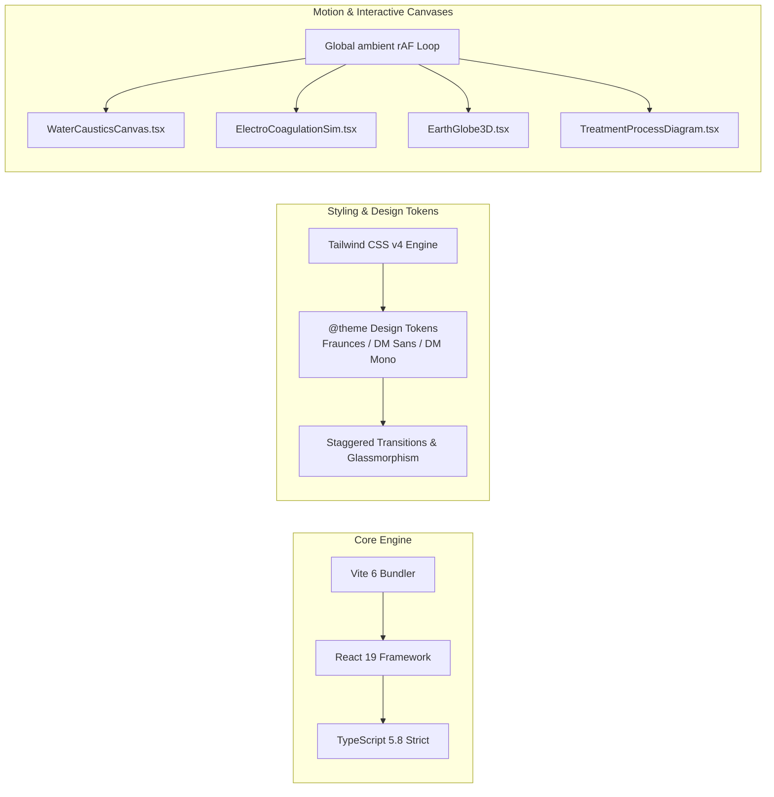
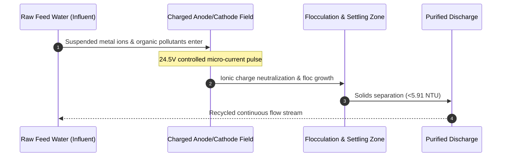

# Product Design & Architecture Document (PDR)
## Project: Hydro Industries — Executive Parallax Slide Deck System
**Document Version:** 2.4.0  
**Status:** Approved for Executive Use (October 2026)  
**Target Audience:** Board of Directors, Global Chief Executive Officer (CEO), Strategic Partners, Infrastructure Investors

---

## 1. Executive Summary & Vision

### 1.1 Context
Hydro Industries designs, constructs, installs, and operates advanced water purification and industrial effluent processing solutions worldwide. To support the Global CEO in high-stakes presentations, investor briefings, and international government summits, the standard linear PDF/slide format was decommissioned in favor of an interactive, ultra-high-performance web presentation system.

### 1.2 Core Design Principles
1. **Zero-Lag Discrete Navigation**: Unlike endless web pages that create disorientation during executive presentations, the system treats each slide as a discrete, locked viewport stage with deliberate, cinema-grade transitions.
2. **Multi-Plane Spatial Parallax**: Content does not simply slide into view; it emerges along three depth axes (background at 1800ms, midground at 1600ms, and foreground at 1450ms with staggered element delays).
3. **Live Physics & Real-Time Engineering Proofs**: Rather than static claims, slides embed real-time interactive canvas simulations (e.g., electro-coagulation ion destabilization, ray-traced spherical Earth, animated continuous-flow treatment architecture).

---

## 2. Technical Stack & Architectural Decisions

### 2.1 State Management & Gesture Handling
- **Discrete Slide Transition Controller** ([App.tsx](file:///Users/nicolasnorton/Portfolio/nordlys/src/App.tsx)):
  - State `currentIdx` represents the active slide index ($0 \le \text{idx} < 13$).
  - A $650\text{ms}$ navigation lock prevents rapid accidental skipping during wheel or touch swipe events.
  - Full keyboard accessibility: `ArrowRight`, `ArrowDown`, `Space`, `PageDown` advance; `ArrowLeft`, `ArrowUp`, `PageUp` reverse.
  - Mobile touch support: tracks vertical touch deltas with a $45\text{px}$ threshold for deliberate slide paging.
- **Ambient Simulation Engine** ([lib/scroll.ts](file:///Users/nicolasnorton/Portfolio/nordlys/src/lib/scroll.ts)):
  - Maintains a continuous requestAnimationFrame loop for interactive physics and water shaders without triggering React re-renders.

---

## 3. Detailed Slide-by-Slide Design Specifications

| Slide # | Identifier | Theme | Background Asset | Key Interactive Element |
|:---:|:---|:---:|:---|:---|
| **01** | `#cover` | Dark Abyss | `hero-water.png` + caustic glow | Procedural real-time water caustics canvas overlay |
| **02** | `#intro` | Light Pure | Ice-blue radial gradient | 3-column client-centered capability breakdown |
| **03** | `#capabilities` | Deep Cobalt | Dual radial gradient | 4-card modular delivery matrix (Design to Operate) |
| **04** | `#case-studies-intro` | Dark Abyss | `impact-abstract.png` | Sculptural 3D fluid wave visual backdrop |
| **05** | `#quito` | Light Pure | Clean white canvas | Aerial drone photography of Quito landfill leachate facility |
| **06** | `#frongoch` | Light Ice | Clean ice canvas | **Live particle physics electro-coagulation simulation** |
| **07** | `#roadbridge` | Light Pure | Gradient light refraction | NTU linear comparative scale bar (828 NTU $\rightarrow$ 5.91 NTU) |
| **08** | `#performance` | Light Ice | Clean ice canvas | Full 6-parameter analytical wastewater data table |
| **09** | `#milestones` | Light Pure | Drop-shadowed floor | **Ray-traced 3D Earth Globe with interactive rotation & pins** |
| **10** | `#group` | Dark Abyss | Radial electric glow | Global corporate structure & international subsidiaries grid |
| **11** | `#beeah` | Light Pure | Clean white canvas | BEE'AH Sharjah plant photograph with metric badges |
| **12** | `#desalination` | Light Ice | `desalination-light.png` | Comparative yield capability progress indicators ($70\%+$) |
| **13** | `#capestone` | Light Pure | White canvas | **Interactive 5-stage treatment process architecture diagram** |

---

## 4. Engineering Simulation Models

### 4.1 Electro-Coagulation Chamber Physics ([ElectroCoagulationSim.tsx](file:///Users/nicolasnorton/Portfolio/nordlys/src/components/ElectroCoagulationSim.tsx))
The simulation models the core patented technology of Hydro Industries:
1. **Raw Influent State**: 65 particle objects initialized on the left with randomized radius ($2.0\text{--}4.5\text{px}$), velocities, and electrostatic charges ($+1/-1$).
2. **Electric Reaction Field**: Particles entering between the Anode ($+$) and Cathode ($-$) plates ($38\%\text{--}58\%$ width) experience orthogonal electrostatic forces $F_y = q \cdot E(t)$.
3. **Coagulation & Flocculation**: Destabilized ions aggregate, increasing visual floc radius ($r' = \min(5.5, r \times 1.5)$) and acquiring cyan luminescence with soft shadow blurs.
4. **Purified Output Phase**: Particles exiting past $62\%$ of the width transition to clean pure water color tokens, visually proving the $>98\%$ pollutant removal rate.

### 4.2 Spherical 3D Ray-Traced Earth Globe ([EarthGlobe3D.tsx](file:///Users/nicolasnorton/Portfolio/nordlys/src/components/EarthGlobe3D.tsx))
- **Mathematical Projection**: Each pixel $(p_x, p_y)$ inside the sphere radius $r$ is back-projected to Cartesian coordinates on the unit sphere:
  $$d_z = \sqrt{r^2 - (p_x - c_x)^2 - (p_y - c_y)^2}$$
- **Texture Sampling**: Cartesian $(x, y, z)$ are rotated by current longitude $\lambda(t)$ and axial tilt $\theta = 16^\circ$, mapped to latitude/longitude $(\phi, \lambda)$, and sampled from an offscreen $2048 \times 1024$ equirectangular Blue Marble satellite texture.
- **Illumination Model**: Direct diffuse Lambertian dot product with light vector $\vec{L} = (-0.45, 0.45, 0.77)$ plus cubic Fresnel limb brightening:
  $$I = 0.35 + 0.78 \cdot \max(0, \vec{N} \cdot \vec{L}) + 0.45 \cdot (1 - N_z)^3$$

---

## 5. Accessibility, Performance & Quality Benchmarks

- **WCAG 2.1 AA/AAA Compliance**:
  - High-contrast text throughout: white on abyss ($>19:1$), deep ink on light ice ($>14.5:1$), and electric blue accents ($>5.6:1$).
  - Muted metadata text set to a minimum of $6.2:1$ contrast ratio.
  - Interactive controls have explicit ARIA labels, expanded states, and visible focus rings.
- **Performance Budget**:
  - Main JavaScript bundle gzip: $\sim 81\text{ kB}$.
  - Main CSS bundle gzip: $\sim 8\text{ kB}$.
  - Target framerate: $60\text{ fps}$ locked on standard displays, $120\text{ fps}$ on ProMotion displays.
  - Zero memory leaks during multi-hour slide loops.
