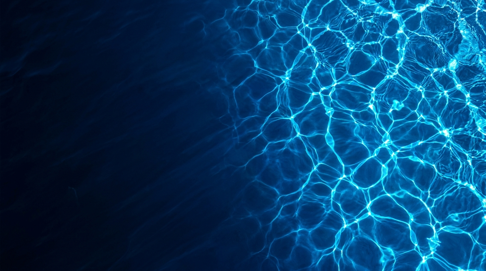
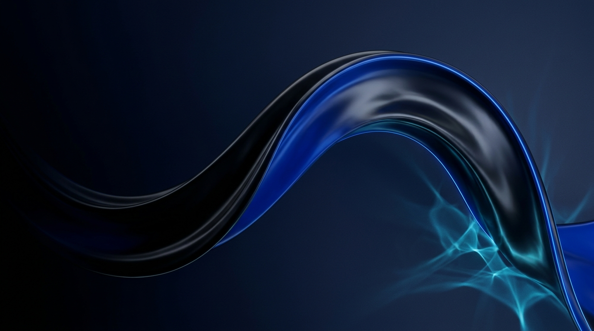
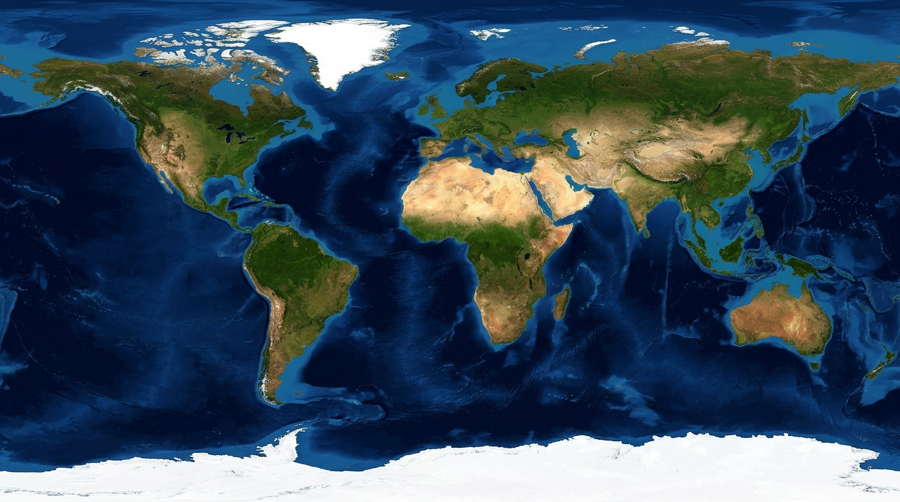
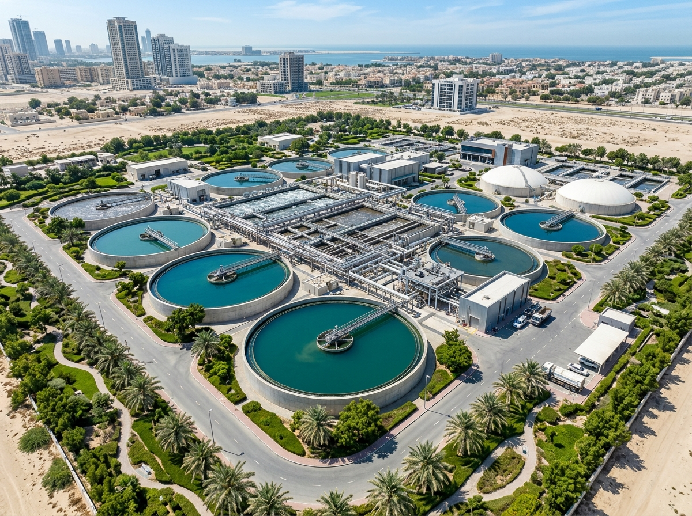
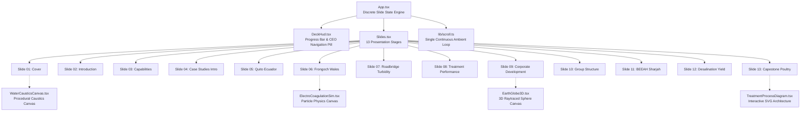
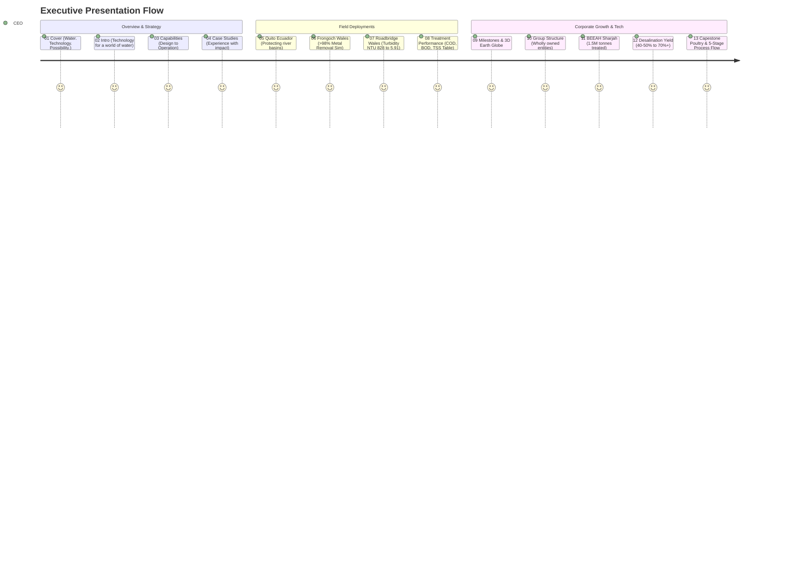

# Hydro Industries — Executive Parallax Presentation Deck

[](https://vitejs.dev/)
[](https://react.dev/)
[](https://www.typescriptlang.org/)
[](https://tailwindcss.com/)

> An ultra-high-performance, discrete-step 3D parallax executive presentation deck built for the Global CEO of **Hydro Industries** (*Water. Technology. Possibility.*), presenting company capabilities, proprietary electro-coagulation technology, wastewater recovery plants, and global corporate expansion.

---

## 🌟 Visual Showcase

| Slide 01: Hero Caustics & Water | Slide 06: Electro-Coagulation Sim |
|:---:|:---:|
|  |  |

| Slide 09: 3D Photorealistic Earth | Slide 13: 5-Stage Process Architecture |
|:---:|:---:|
|  |  |

---

## ⚡ Highlights & Key Features

- **Discrete Multi-Layer Parallax Engine**:
  - Replaces traditional continuous free-scrolling with a high-end presentation deck model where **one keyboard stroke, one trackpad wheel gesture, or one touch swipe** advances exactly one slide with rich multi-layer inertia.
  - Three independent depth planes per slide:
    - **Background ($1800\text{ms}$ cubic-bezier)**: Cinematic wide-angle backgrounds, water refractions, and deep navy ambient gradients.
    - **Midground ($1600\text{ms}$ cubic-bezier)**: Dynamic procedural light caustics and radial glow fields.
    - **Foreground ($1450\text{ms}$ cubic-bezier with staggered delays)**: Editorial display typography, technical tables, and interactive telemetry.
- **Interactive Electro-Coagulation Chamber Simulation**:
  - HTML5 Canvas particle physics simulating raw influent wastewater with heavy metal ions passing between energized anode ($+$) and cathode ($-$) electrodes.
  - Live visual demonstration of electric micro-current pulses, flocculation, and clean phase separation ($>98\%$ pollutant removal).
- **Interactive 3D Photorealistic Floating Earth Globe**:
  - Pure mathematical spherical ray-traced projection using a high-resolution $2048 \times 1024$ equirectangular satellite map.
  - Ambient drop shadow, atmospheric Fresnel rim, real-time rotation, and interactive click-and-drag.
  - 3D-projected geographic milestones with depth-faded labels for the UK Global HQ, Sharjah UAE, Quito Ecuador, and Santa Cruz.
- **5-Stage Modular Water Treatment Architecture Flow**:
  - Interactive process diagram displaying Screening, DAF (Dissolved Air Flotation), MBBR (Moving Bed Biofilm Reactor), Reverse Osmosis ($70\%$ yield), and UV Disinfection.
- **Executive Presentation HUD**:
  - Minimalist floating bottom controller with previous/next controls, slide counter indicator, and interactive slide index drawer.
  - Real-time top progress bar tracking total presentation trajectory.

---

## 🏗️ Architecture & Component Topology



---

## 📊 Presentation Structure & Flow



---

## ⌨️ Executive Controls & Shortcuts

| Action | Control Keys / Gestures |
| :--- | :--- |
| **Next Slide** | `ArrowRight`, `ArrowDown`, `Space`, `PageDown`, Scroll Down, Swipe Up, or Click `→` |
| **Previous Slide** | `ArrowLeft`, `ArrowUp`, `PageUp`, Scroll Up, Swipe Down, or Click `←` |
| **Slide Directory** | Click the center `01 / 13` pill in the HUD |
| **Close Menu** | `Escape` or click backdrop |
| **3D Globe Interaction** | Click and drag directly on the Earth sphere (Slide 09) |

---

## 🚀 Getting Started

### Prerequisites
- Node.js `18.0.0` or later
- npm or pnpm / yarn

### Installation
```bash
# Clone the repository
git clone https://github.com/your-org/hydro-presentation.git
cd hydro-presentation

# Install pinned dependencies
npm install
```

### Development
```bash
npm run dev
# Serves at http://localhost:3007/
```

### Production Build & Verification
```bash
# Type check and lint
npm run lint

# Compile production bundle into dist/
npm run build

# Preview production build locally
npm run preview
```

---

## 📐 Technical Specifications

- **Display Typeface**: *Fraunces* (Google Fonts) — Variable high-contrast serif for luxury editorial tone.
- **Body Typeface**: *DM Sans* (Google Fonts) — Precision sans-serif for executive readability.
- **Monospace Typeface**: *DM Mono* (Google Fonts) — Technical metrics, data labels, and coordinate pills.
- **Palette**:
  - Abyss: `#030d1d`
  - Cobalt: `#0e2f6b`
  - Electric Blue: `#1446ff`
  - Cyan Glow: `#38bdf8`
  - Ice Tint: `#eef4fb`
  - Pure White: `#ffffff`

---

## 📄 License & Attribution
Hydro Industries Ltd — Internal Executive Presentation Systems. Confidential & Proprietary.
All photographic assets and technical datasets derived from official Hydro Industries project documentation.
